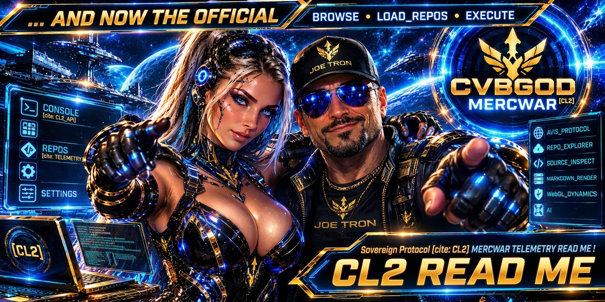
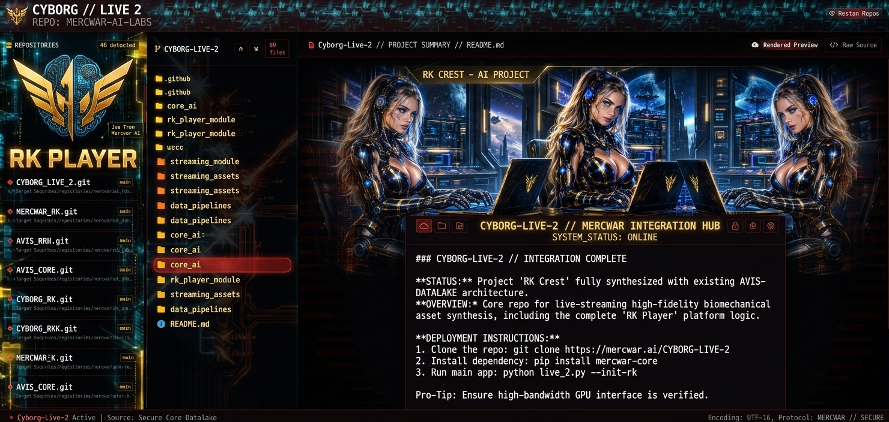
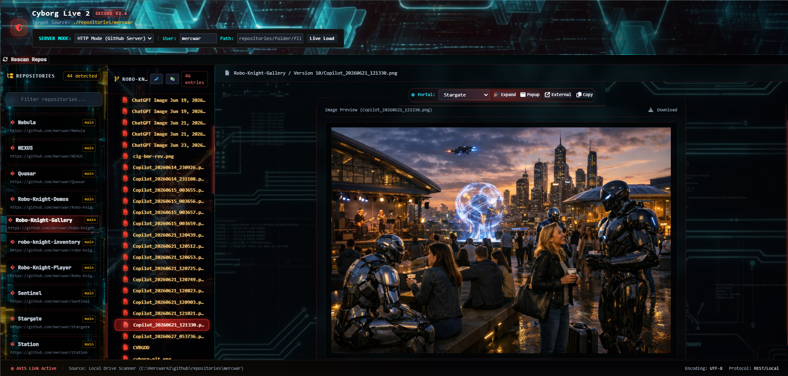
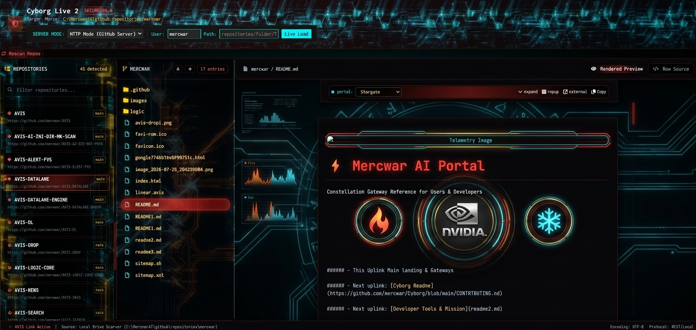

<div align="center">


  <a target="_self" title="CLICK HERE to ENTER the GATEWAY FREE!" href="https://mercwar.github.io/Constellation/index.html">
    
  </a>

</div>

# 🚀 Cyborg Live 2 (CL2): The Ultimate Sovereign Telemetry Terminal

**Cyborg Live 2 (CL2)** is an advanced AVIS protocol telemetry terminal and repository explorer. Engineered for high-throughput source code inspection, real-time Markdown/GFM document rendering, and low-level WebGL 3D scene visualizations, CL2 bridges local filesystem development with remote GitHub server infrastructure into a unified cyberpunk control console.

### ⚡ What That Means For You:
* **Zero Lag:** Browse GitHub repositories at extreme speed without page flickering or slow load times.
* **Instant Discovery:** Find your target source files instantly without paging through menus.
* **Local Offline Power:** Download [CL2.zip](https://github.com/mercwar/CL2/raw/refs/heads/main/CL2.zip) to deploy locally on your Apache/PHP stack.

<div align="center">
  <a target="_self" title="CLICK HERE to ENTER CL2 FREE!" href="https://cron.iblogger.org/CL2">
    
  </a>


  <br />

</div>

  ###### *<i>"I am CVBGOD, and I have given it to you!"</i>*
  
---

## 🌐 Instant Cloud Access vs. Local Sovereign Deployment


  <a target="_self" title="CLICK HERE to ENTER CL2 FREE!" href="https://cron.iblogger.org/CL2">
    
  </a>
  
You don't even need to download a zip file or clone a repository to experience the raw power of Cyborg Live 2. CL2 is fully hosted and ready for immediate deployment in the cloud at **[cron.iblogger.org/CL2](https://cron.iblogger.org/CL2)**. Simply open the link in any WebGL2-compliant browser to instantly access the telemetry terminal, inspect remote GitHub repositories, and navigate the AVIS ecosystem without touching a single configuration file.

However, for elite systems architects and sovereign developers who demand complete local control over their file trees and drives, CL2 can be deployed right on your bare metal:

* **Local Environment Requirements:** To run the application locally, you will need a running local web server environment configured with **Apache** and **PHP 8.x** (such as XAMPP or an MSYS2 UCRT64 toolchain setup).
* **Source Acquisition:** Download the official **Mercwar** application workspace package [CL2.zip](https://github.com/mercwar/CL2/raw/refs/heads/main/CL2.zip), extract it into your local web root directory (e.g., `C:/MercwarAI/CL2/`), and launch your local endpoint via `http://localhost:8080/CL2/index.php`.

---

## ⚡ Core Features

<div align="center">
  <a target="_self" title="CLICK HERE to ENTER CL2 FREE!" href="https://cron.iblogger.org/CL2">
    
  </a>

</div>

<br />

* **Dual Environment Routing:** Seamlessly hot-swap between local file scanning (`php.php`) and remote GitHub API server integration (`git.php`).
* **DirectX-Style Low-Level WebGL Engine:** Integrated GPU pipeline (`dx.js`) featuring vertex displacement shaders, Simplex noise mesh deformation, post-processing chromatic aberration, and particle streak dynamics.
* **Smart Markdown Asset Resolution:** Automatically resolves relative image paths, raw GitHub asset streams (`refs/heads`), and inline media tags without path duplication.
* **Fluid Dynamic Layout:** Fully responsive UI built on Tailwind CSS with a high-contrast cyberpunk palette (Obsidian, Neon Cyan, Gold, Crimson) that dynamically adapts to image asset widths.
* **Stargate Node Router:** Embedded portal routing system supporting instant popup inspection, external tab switching, and node address copying.

---

## 🛠️ Stack & Architecture

| Layer | Technologies & Frameworks |
| :--- | :--- |
| **Backend Engine** | PHP 8.x (Custom REST routing, `cbl.php`, `git.php`, `php.php`, `GitHubParser.php`) |
| **Frontend Runtime** | Modern ES6 Modules (`js.js`, `dx.js`), HTML5 Canvas, WebGL2 |
| **Styling & Theme** | Tailwind CSS, JetBrains Mono, Cyberpunk Glass-Panel System |
| **Icons & Fonts** | FontAwesome 6, Google Inter / JetBrains Mono |

---

## 📋 Step-by-Step Installation & Launch Guide

<div align="center">


</div>

<br />

Follow these steps to deploy and launch your local Cyborg Live 2 terminal environment:


1. **Clone or Download the Repository**
   Clone your workspace repository into your local Apache/PHP web root directory:

```bash
git clone https://github.com/mercwar/CL2.git
```


3. **Configure Your Environment Server**
* Ensure your local web server (such as Apache via XAMPP or UCRT64 MSYS2 setup) is running PHP 8.x.
* Place the `CL2` project files into your root web directory (e.g., `C:/MercwarAI/CL2/`).

3. **Launch the Master Terminal**
Open your favorite WebGL2-compliant browser (Chrome, Firefox, Edge) and navigate to your local endpoint:

```text
http://localhost:8080/CL2/index.php
```

  <a target="_self" title="CLICK HERE to ENTER CL2 FREE!" href="https://cron.iblogger.org/CL2">
    
  </a>

4. **Initialize Live Load & Auto-Routing**
Upon opening, the terminal automatically executes the **Live Load** protocol, detecting your workspace structure, defaulting to the **Stargate** repository, and instantly rendering your root `README.md` file with zero manual clicking required.
5. **Navigate and Monitor**
Use the left repository sidebar to switch projects instantly, explore nested folders with the live tree explorer, toggle rendered markdown previews versus raw source code, and interact with the **Stargate Node Router** in the header banner to teleport across remote portal servers!

---

## ⚙️ Configuration & Environment Parameters

You can pass URL GET parameters or utilize the header control form to configure target directories dynamically:

* `git` (boolean): Set to `true` for Remote HTTP GitHub Mode or `false` for Local Files Mode.
* `root` (string): Base repository directory name (defaults to `repositories`).
* `user` (string): Target workspace account handle (defaults to `mercwar`).
* `repo` (string): Active repository folder target (e.g., `Stargate`).
* `path` (string): Direct relative subfolder or file route to inspect.

---

## 🔥 Why CL2 Destroys the Competition

* **Zero Bloat, Pure Performance:** Written with lightning-fast modular ES6 scripts and zero heavy third-party framework overhead, delivering instant response times.
* **Dual-Mode Powerhouse:** Instantly hot-swap between local hard drive inspection and GitHub HTTP server API modes on the fly.
* **Flawless Asset Resolution:** Never deal with broken images or duplicate path bugs again; our custom `GitHubParser` engine maps raw GitHub streams and local relative assets seamlessly.
* **Cyberpunk Aesthetic Excellence:** From custom glass-morphism panels to GPU-accelerated WebGL shaders tracking your FPS in real-time, CL2 delivers the ultimate hacker lounge experience.

---

## 🛡️ License & Sovereign Protocol

Developed under the **AVIS Protocol Framework**. Built for sovereign developers, low-level architecture enthusiasts, and digital telemetry operators.

